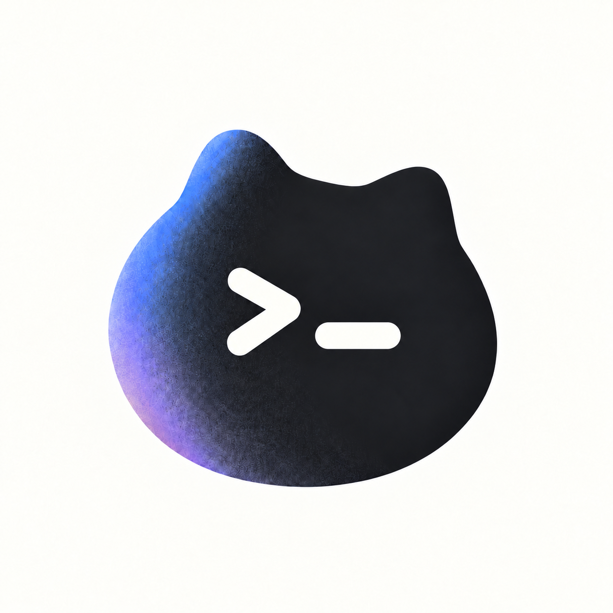

<p align="center">
  
</p>

# Mio

Mio 是一个无头 Rust 编程 Agent 引擎，可在终端独立运行，也可通过 Rust 库直接嵌入宿主应用。

[官方网站](https://ravomi.github.io/Mio/) · [技术文档](https://ravomi.github.io/Mio/documentation.html) · [安装指南](docs/installation.md) · [程序状态规范](docs/program-status.md) · [源码来源](docs/rig-source.md) · [示例](examples/host.rs) · [许可证](LICENSE)

本文涵盖 [CLI 与工具过滤](#常用-cli-使用示例与工具过滤)、[RPC 运行控制](#rpc-运行控制与协议交互)、[异步审批](#异步审批机制---approve)、[模型与子代理](#模型切换thinking-思考等级与子代理)、[上下文与会话](#上下文预算管理与会话持久化)。

## 源码安装与快速开始

源码编译需要 Rust 1.95 或更新版本。其他分发方式及发布状态见 [安装指南](docs/installation.md)。从 `main` 分支克隆并编译：

```bash
git clone https://github.com/Ravomi/Mio.git
cd Mio
cargo install --path . --locked
mio --help
```

配置 OpenAI 兼容模型服务并启动：

```bash
export MIO_BASE_URL='https://your-provider.example/v1'
export MIO_MODEL='your-model-name'
export MIO_API_KEY='your-key'

mio --cwd /path/to/project -p '阅读 Cargo.toml 并解释项目依赖'
mio --cwd /path/to/project                 # 终端交互模式
mio --cwd /path/to/project --resume -p '继续上次任务'
mio --cwd /path/to/project --json -p '统计代码行数'
```

## 核心能力与架构

- **同核两用**：`mio` CLI 与 `mio-coding-agent` Rust 库共享同一 Agent 工具循环；支持 `text`、`json`（JSON Lines 事件流）与 `rpc` 运行模式。
- **工作区代码工具**：内置 `read`、`write`（原子写入）、`edit`（唯一匹配精确替换）、`bash`（120 秒超时）、`grep`、`find`、`ls`；支持 `--tools`、`--exclude-tools` 与 `--no-tools` 过滤。
- **原生子代理**：通过 `--subagents` 启用独立会话的子代理，探索任务默认只读，支持后台异步委派、状态查询、取消与续接。
- **上下文管理与项目规则**：自动发现祖先目录与当前目录的 `AGENTS.md`、`CLAUDE.md`，支持 `@file` 内容展开、项目 Skills（`.mio/skills/`）与提示词模板（`.mio/prompts/`）。
- **会话持久化与导出**：任务历史原子写入 `.mio/sessions/`，支持恢复（`--resume`）、分叉（`--fork`）与单文件 HTML 导出（`--export`）。
- **外部扩展**：支持通过 stdio JSON-RPC 2.0 连接 MCP Server（`.mio/mcp.json`），以及通过 `mio-plugin.json` 规范加载插件。
- **终端状态报告**：仅在 CLI 文本模式且 stderr 为 TTY 时输出 OSC 7501 状态序列，详见 [OSC 7501 状态规范](docs/program-status.md)。

## 常用 CLI 使用示例与工具过滤

以下示例覆盖会话恢复、审批、工具集裁剪及子代理调度：

```bash
# 常用提示词与会话续接
mio --cwd /path/to/project -p '阅读 Cargo.toml 并解释项目依赖'
mio --cwd /path/to/project --resume -p '继续上次任务并补充单元测试'
mio --cwd /path/to/project --resume --fork -p '从最新历史分叉出新会话探索方案 B'

# 工具过滤：白名单、增删修改与完全禁用
mio -t 'read,write,edit' -p '只允许文件读写与精确修改'
mio --subagents -t '+subagent,-bash' -p '在默认工具集基础上禁用 bash 并开启 subagent'
mio -xt 'bash,write' -p '排除命令执行与直接写入'
mio -nt -p '纯文本问答，禁用所有内置与外部工具'

# 启用受限/探索子代理并发
mio --subagents -p '分析整个仓库的代码质量，使用只读子代理并发检索'

# 敏感操作交互审批与无 Shell 模式
mio --approve -p '修改 src/main.rs 并编译'
mio --no-shell -p '仅允许操作文件，禁止执行任何终端 Shell 命令'

# 上下文预算覆盖与自动压缩
mio --context-window 65536 --max-output-tokens 8192 --auto-compact -p '处理超大代码重构'

# JSON Lines 流式输出与 RPC 守护模式
mio --json -p '统计代码行数并输出结构化事件'
mio --mode rpc --cwd /path/to/project --approve
```

### 工具过滤语义说明

- **白名单模式 (`-t` / `--tools`)**：支持全量指定（如 `read,write,bash`）或差量调整语法（以 `+` 或 `-` 开头的项，如 `+subagent,-bash`）。
- **黑名单模式 (`-xt` / `--exclude-tools`)**：明确排除匹配的工具名或通配符，同时作用于直接调用的独立工具及工作区聚合入口。
- **完全禁用 (`-nt` / `--no-tools`)**：禁用所有工具调用能力；与 `--tools` 互斥，同时传入将报错。
- **内置工具列表**：`workspace`、`read`、`write`、`edit`、`bash`（别名 `shell`）、`grep`、`find`、`ls`、`subagent`。

过滤器只决定允许暴露哪些工具；`+subagent` 不会代替 `--subagents` 启用子代理。`--no-shell` 仅禁用 Shell，不禁用文件写入，也不代表 MCP 或插件工具没有外部副作用。默认 CLI 允许文件修改和 Shell 执行，Shell 使用当前用户权限，不是沙箱。`--max-turns N` 控制工具循环预算，范围为 1–256，默认 32。

### CLI 取消与交互恢复

运行任务时按 Ctrl-C，会取消当前请求并清理活动子任务及 Shell 进程；已成功保存的会话保留，已发生的文件修改不回滚。终端交互模式在取消或普通回合错误后继续接受输入；在输入提示符处按 Ctrl-C 则退出。单次 `-p` 任务取消或失败以非零状态退出。终端编辑器支持 Tab 补全和上下键历史，`/status` 查看状态，`/exit` 退出。

## RPC 运行控制与协议交互

使用 `mio --mode rpc` 可启动常驻的 stdio JSONL RPC 服务。每行输入一个 JSON 命令，stdout 每行输出一个 JSON 事件。

stderr 用于诊断，客户端须持续读取 stdout；保持 stdin 打开以接收任务结果，不能把发送完一批 JSON 后立刻关闭管道当作等待完成。完整协议见 [docs/rpc.md](docs/rpc.md)。命令应答表示是否接受命令，不表示任务已经完成。

### 运行控制核心机制

- **队列与启动**：空闲时，`prompt`、`steer` 与 `follow_up` 均可直接开启新回合。运行中时，`prompt` 会被明确拒绝；`steer` 进入专用插队队列（最多排队 64 条），在当前工具安全点注入给模型（若当前轮没有工具调用，则本轮结束后先处理未消费的 steer）；`follow_up`（最多排队 64 条）按 FIFO 队列在当前任务及 steer 彻底完成后顺延启动。
- **引导与状态**：`steer` 在工具完成后附加到工具结果，不中断已发出的模型请求或正在运行的工具。消息须为非空文本且不超过 65536 字节。`get_state` 在运行中可用：`isStreaming` 表示有活动任务，`followUpCount` 为排队数量，`pendingApprovalCount` 为待审批数量；运行中的历史消息数取本轮开始前的已保存快照。
- **状态变更限制**：当 Agent 正在流式处理或工具正在执行时，任何修改会话历史（`compact`、`new_session`、`fork_session`、`set_session_name`）或切换模型（`set_model`）的操作均会被直接拒绝；如需切换，须等待进入空闲或显式发送 `abort`。
- **`abort` 语义**：取消当前模型推理 Future、运行中的工具、活动子进程与子代理，并彻底清空 pending 的 steer 与 follow_up 队列。取消仅停止后续计算，保留上次成功落盘的历史，**绝不回滚已写入文件的磁盘修改**。若当前原本空闲，应答的 `aborted` 字段为 `false`。
- **终止清理与孤儿子进程**：RPC 关闭 stdin (EOF) 会取消活动任务并退出；任务错误清空排队。在 Unix 平台，Mio 启动的 Shell 工具使用独立进程组，取消时终止该进程组；其他平台只保证处理直接子进程。EOF 不保证发出结束事件，客户端还需处理进程退出。

### 可复制的 JSONL RPC 交互示例

#### 启动回合、引导 (Steer) 与追加 (Follow-up)

```json
{"type":"prompt","id":"p1","message":"分析 src/main.rs 并规划重构"}
{"type":"steer","id":"s1","message":"在下一次调用工具时优先检查依赖引入"}
{"type":"follow_up","id":"f1","message":"重构规划完成后接着生成迁移计划"}
{"type":"get_state","id":"st1"}
```

标准应答与关键生命周期事件流：

```json
{"type":"response","command":"prompt","id":"p1","success":true,"data":{"status":"started"}}
{"type":"text","data":"正在分析项目结构..."}
{"type":"tool_started","data":{"operation":"read","target":"src/main.rs"}}
{"type":"tool_finished","data":{"operation":"read","target":"src/main.rs","result":{"Ok":"fn main() {}"}}}
{"type":"done","session":"/path/to/project/.mio/sessions/example.json","messages":2}
{"type":"agent_settled","status":"completed"}
```

> **注意**：`done` 表示单次回合已成功提交会话状态（`--no-session` 时仅更新内存，`session` 为 `null`），但如果存在排队的 `steer` 或 `follow_up`，系统仍会继续流转；客户端应以收到 `agent_settled`（状态为 `completed`、`cancelled` 或 `error`）作为整个工作链彻底静止的标志。

#### 中途取消任务 (`abort`)

```json
{"type":"abort","id":"a1"}
```

应答示例：

```json
{"type":"response","command":"abort","id":"a1","success":true,"data":{"aborted":true}}
{"type":"agent_settled","status":"cancelled"}
```

## 异步审批机制 (--approve)

启动时传入 `--approve` 参数后，写文件 (`write`、`edit`) 及命令执行 (`bash`) 等敏感操作需要显式授权：

- **TTY / 非 TTY / RPC 差异**：普通 CLI/JSON 模式在没有终端 TTY 交互能力时会**直接拒绝**敏感操作；而在 RPC 模式下，系统开启非阻塞的异步审批管道，由引擎向客户端发送 `approval_request`。
- **并发与超时**：待处理审批请求上限为 64 个（超过则立即拒绝新请求）。每个审批请求拥有 120 秒超时（`120000` ms），以单调时钟计算。超时未处理自动转为拒绝，对应的 pending 名额立即释放。
- **拒绝、取消与清理**：
  - 若客户端回复 `approved: false` 或超时，工具调用返回失败报错，模型知晓后可规划回退策略；
  - 任务发生 `abort` 或连接 EOF 时，所有未决审批立即被取消并丢弃，尚在等待批准的工具不会执行；已经执行的文件修改不回滚；
  - 客户端针对已过期、不存在或已判定的 `request_id` 提交响应时，引擎返回 `success: false` 并附带说明。
- **审批范围**：审批不仅限制当前会话的直接工具，也约束被授权写入的子代理。

#### RPC 审批交互示例

引擎发出审批挂起请求：
```json
{"type":"approval_request","request_id":"c88fcfb5-2fd5-41d3-9bc3-066e04746654","operation":"write","target":"src/main.rs","timeout_ms":120000}
```

客户端确认批准（或传入 `"approved": false` 拒绝）：
```json
{"type":"approve_response","request_id":"c88fcfb5-2fd5-41d3-9bc3-066e04746654","approved":true}
```

引擎回执：
```json
{"type":"response","command":"approve_response","id":"c88fcfb5-2fd5-41d3-9bc3-066e04746654","success":true,"data":{"approved":true}}
```

## 模型切换、Thinking 思考等级与子代理

### 模型切换与供应商映射

- **空闲切换**：空闲时可通过 RPC 发送 `{"type":"set_model","id":"m1","model":"deepseek/deepseek-chat"}` 或在交互中使用 `/model <name>`。若只提供模型名，则沿用当前供应商连接；若携带供应商前缀（如 `deepseek/` 或 `antigravity/`），则完整同步对应的端点、凭据及服务配置；若切回之前已配置过的供应商，会自动恢复其先前设置的基地址与参数。
- **凭据解析**：优先读取供应商专用环境变量（如 `DEEPSEEK_API_KEY`），未指定时回退到 `MIO_API_KEY`；绝不跨供应商混用专用密钥。`custom` 供应商可读取 `MIO_API_KEY` 或 `OPENAI_API_KEY`。不支持的原生协议或缺少所需账户时，切换失败并保持原配置不变。
- **思考等级 (Thinking Level)**：
  - 等级为 `off`、`minimal`、`low`、`medium`、`high`、`xhigh`、`max`；CLI 还接受 `none`、`min`、`med` 别名。RPC 使用规范等级名。
  - 通过 CLI `--thinking <level>`、模型简写 `[provider/]model[:thinking]`、交互命令 `/thinking <level>` 设置；CLI 显式参数优先于简写。RPC 示例：`{"type":"set_model","id":"m2","model":"deepseek/deepseek-chat","thinking":"high"}`。
  - 通用 OpenAI 兼容接口与 Codex 原生传递思考参数；具体等级支持取决于模型。已知模型能力会在请求前本地校验，未知模型仍可能被服务端拒绝。无效交互调整报告错误且保留原配置。
  - DeepSeek API 严格仅接受 `off`、`low`、`high`、`max`（传入 `medium` 将被明确拒绝）；DeepSeek 网页适配器暂不支持开启思考。
  - Antigravity 映射至其底层的专有 thinking 级别配置。

### 原生子代理 (Subagents)

- **开启与并发隔离**：使用 `--subagents` 标志显式启用。最大允许 4 个并行子会话，单个运行最长超时 600 秒。子代理在内存中维护独立历史（不污染主干会话）。
- **权限与边界**：委派任务时默认 `read_only: true`（禁用写入、编辑与 Shell 执行）；仅在父任务显式指定且允许时才放开写权限。子代理**永远不会再次获得派生子代理的权限**（无法层叠派生）。
- **继承与同步**：主代理中发生的模型切换、思考等级调整及交互配置变更，均自动同步应用至后续子任务（包括续接已有子会话）。
- **安全与控制**：子代理支持主动状态查询、等待与中途取消。主代理取消或失败时清理活动子任务；若父回合结束时还有运行中的子任务，会取消它们并报告错误，不能将未收集结果视为完成。子代理提供 `delegate`、`status`、`snapshot`、`list`、`kill`、`fork` 操作，状态等待最长 30 秒；子会话随进程退出丢失，工具过滤和审批不构成操作系统沙箱。

## 上下文预算管理与会话持久化

### 预算参数与默认值

- **容量目录与回退**：内置知名模型窗口容量目录。对于未知模型，默认回退容量为 `32768` tokens。可通过 `--context-window <N>`（至少 1024）覆盖部署容量。
- **输出预留 (`--max-output-tokens`)**：默认值为 `4096`、容量的四分之一（向下取整）和目录输出上限三者的最小值，并额外保留 5% 的工程安全余量。DeepSeek 网页适配器因无原生输出上限支持，禁止显式设置 `--max-output-tokens`。

输出上限必须为正数，为输入和 5% 余量留出空间，且不能超过已知目录的输出上限；它同时控制原生请求的输出上限和本地预留。DeepSeek 网页端的默认预留仅参与输入预算。`get_state.data.contextBudget` 返回 `context_window`、`max_output_tokens`、`source`（`catalog` / `override` / `fallback`）。切换模型重新查询目录，显式覆盖保持不变，后续子任务继承相同设置。

### 工具续轮检查与压缩边界

- **逐轮预算判定**：在主输入以及**每一次工具结果返回准备发起下一轮推理前**，均重新严格计算：`系统指令 + 工具定义模式 + 历史上下文 + 活动工具结果 + 输出预留` 的保守 UTF-8 字节占用（本地启发式估算，非分词器）。
- **安全交互边界**：预算超限时，压缩仅在**完整的工具调用/响应成对边界**触发，绝不切断单独半截工具调用；系统提示词与当前轮的工具上下文会被完好保护。
- **预算摘要**：生成的预算摘要上限为 4096 字节，优先抽取近期关键提问与关键工具输出；该预算压缩仅动态作用于当前单次请求载荷，**不会破坏持久化的原始会话完整性**。
- **历史压缩区别**：`/compact`、RPC `compact` 和可选的 `--auto-compact` 会更新会话历史；自动历史压缩阈值为 512 KiB。压缩采用本地抽取摘要，可能丢失细节。每请求预算检查不需要启用 `--auto-compact`。当前预算估算仅支持文本上下文，媒体消息会明确拒绝；模型目录容量可能与实际部署不同，应按部署设置覆盖值。
- **超限阻断**：若即便压缩后仍无法容纳当前必须发送的内容，引擎阻止当前请求发往服务端，立即发出清晰的 `Context budget:` 错误，并在 RPC 中以 `agent_settled` 的 `error` 状态结束；后续输入仍可继续。当前超限请求不会发出，但先前已完成的请求仍可能计费。

### 会话持久化与失败语义

- **原子更新**：会话日志持久化写入 `.mio/sessions/`，使用临时文件配合原子替换，降低写入中断导致半份文件的风险；这不是任意硬件故障下的数据恢复保证。成功落盘后才更新内存中的当前会话。
- **失败安全**：RPC 模式下的历史压缩 (`compact`)、新建 (`new_session`)、分叉 (`fork_session`) 与重命名 (`set_session_name`) 均以**文件落盘成功作为返回 success 的前置条件**。若磁盘已满或写入失败，内存中完整保留原有会话状态并返回详细错误，调用方可重试会话操作；模型与工具执行中已发生的外部副作用不回滚。传入 `--no-session` 时完全禁用磁盘落盘，仅在内存中留存。

```bash
mio --list-sessions
mio --session '会话路径或唯一UUID前缀或名称' -p '继续任务'
mio --resume --fork --name '备选方案' -p '探索另一种实现'
mio --resume --export session.html
mio --no-session -p '本次不保存会话'
```

## 扩展与验证边界

项目规则支持祖先与当前目录的 `AGENTS.md`、`CLAUDE.md`，可用 `--no-context-files` 关闭；`--skill NAME` 加载项目 `.mio/skills/` 中的技能，`--template NAME` 使用 `.mio/prompts/NAME.md` 并替换 `$ARGUMENTS`。`--no-context` 关闭项目上下文，细分开关还有 `--no-skills` 和 `--no-prompt-templates`。

MCP 配置位于 `.mio/mcp.json`，通过 stdio JSON-RPC 2.0 连接；`--no-mcp` 关闭发现，`--exclude-tools 'mcp__*'` 可过滤工具。插件使用 Mio 原生 `mio-plugin.json`，可通过 `--plugin-init`、`--plugin-validate`、`--plugin-install`、`--plugin-list` 和 `--plugin-remove` 管理。它不是 Pi 的 TypeScript 扩展运行时，尚未对齐 Pi 的完整 TUI、交互会话树与扩展生态。

内置供应商目录不代表各家的专有协议均已适配。当前验收集中于 Linux 和本地模拟服务，未声明其他平台、预编译分发包或所有真实账号服务均已通过验收。

## 开发与测试

在提交前，严格通过以下四项验收检查：

CI 固定使用 Rust 1.95.0；本地验收请使用同一版本，避免不同 Clippy 版本造成结果差异：

```bash
cargo +1.95.0 fmt --check
cargo +1.95.0 check --all-targets --locked
cargo +1.95.0 test --locked
cargo +1.95.0 clippy --all-targets --locked -- -D warnings
```

测试集涵盖本地 HTTP 模拟、CLI 读写与恢复、边界安全和会话持久化，无需调用外部真实服务。

## 项目架构与许可证

项目采用三层分层架构：`mio-core`（模型与流式协议）、`mio-agent`（Agent 循环与工具调用）与 `mio-coding-agent`（原 `mio-agent` 重命名，提供编程工具、会话与 CLI）。

项目采用 [MIT 许可证](LICENSE) 发布。依赖许可证与源码来源记录见 [CREDITS.md](CREDITS.md) 和 [licenses/](licenses/)。
